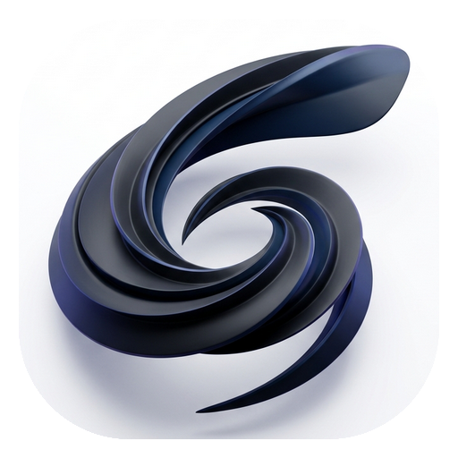

# Focus Flow (心流浮球)

<div align="center">



### AI 任务中枢 · 桌面物理悬浮球 · 科学番茄心流钟

[](LICENSE)
[](https://github.com/YunHaiKong/focus-flow)
[](https://www.electronjs.org/)
[](https://nodejs.org/)

**与任意 AI（Antigravity、Claude Code、Cursor、Windsurf、WorkBuddy 等）无缝联动，把对话中的任务瞬间提取到桌面物理悬浮球。**  
鼠标悬停即可透视今日待办与番茄钟，双击即刻进入沉浸心流。

[在线轻量版体验](https://yunhaikong.github.io/focus-flow/) · [快速上手](#-快速开始) · [AI Agent 接入体系](#-全平台-ai-agent-接入体系) · [API 文档](#-本地-http-api-规范)

</div>

---

## 🌟 核心特性一览

### 1. 🎱 物理桌面悬浮球
- **无边框置顶与贴边吸附**：常驻桌面最顶层，支持鼠标自由拖拽，自动记忆屏幕停留坐标；贴边时自动呈现微光胶囊形态。
- **动态手势与双模式展开**：
  - **悬停探测**：鼠标指针停靠 0.8 秒柔和展开任务面板；移开自动收缩，零打扰办公。
  - **快捷点击**：单机即时展开/收起；**双击悬浮球直接开始/暂停当前番茄专注**。
- **实时状态感知角标**：
  - 待办状态：右上角显示今日待完成任务数字红点。
  - 专注状态：角标动态切换为分秒级倒计时（如 `24:59`），无需展开面板即可掌握节奏。

### 2. 🍅 科学番茄工作法 & 专注环
- **标准心流循环**：内置 25 分钟标准专注、5 分钟短休（Short Break）与 15 分钟长休（Long Break）周期机制。
- **高精度 SVG 环形进度圈**：在悬浮球外圈渲染光滑的 SVG 能量进度条，随着专注时间流逝平滑缩进。
- **纯物理合成环境白噪音**：基于 Web Audio API 实时算法生成真实粉红噪音与雨声（Rain Noise），免去外部音频依赖，一键阻隔外界喧嚣。
- **清脆心流提醒音**：专注结束时通过 Web Audio 谐波振荡器播放清脆舒缓的完成和弦音。

### 3. 📋 敏捷待办与智能时间解析
- **智能自然语言时间识别**：内置中文语义解析器，输入「明天下午3点交周报」、「后天开会」、「周五前完成重构」、「10.25 汇报」，自动提取日期与精准时间。
- **双击行内就地编辑 (Inline Editing)**：待办列表中的任意任务，**双击标题即可原地无缝重命名**；按 `Enter` 或失焦自动保存，按 `Esc` 撤销改动。
- **历史记录与专注热力图**：独立全功能管理后台（点击底栏历史图标唤出），内置 **14 天心流贡献热力矩阵**（GitHub Contribution 风格），清晰回溯每日专注时长与任务完成趋势。

### 4. 👕 像素精灵皮肤系统
- **Elysia 治愈陪伴**：内置完整 Elysia · Herrscher of Human 像素表情包皮肤（含 12 种表情状态与配套萌系指针），专注与闲置时展现生动反馈。
- **自由换肤与扩展**：极简设计，只需替换 `desktop/src/sprites/` 目录中的 GIF 序列帧即可定制专属于你的桌面桌宠。

### 5. 🌸 Android 原生桌面桌宠悬浮球
- **系统级真·悬浮球 (`SYSTEM_ALERT_WINDOW`)**：爱莉希雅萌宠直接漂浮在 Android 手机桌面及所有 App 之上，无需保持打开浏览器。
- **一键极速交互**：
  - **单击桌宠**：瞬间滑出待办面板与番茄钟，支持打勾完成、顺延标记、删除与自然语言快速添加。
  - **双击桌宠**：立即启停 25 分钟番茄专注，实时显示倒计时角标。
  - **自由拖拽贴边**：屏幕四周任意拖动，松手自动靠边吸附。
- **未完顺延 ⏩**：一键将昨天和过期待办顺延至今日，自动打上醒目的「顺延 N 天」橙色标签。
- **剪贴板自动嗅探**：手机上复制任何 `#task 待办内容`，后台 2 秒内自动识别日期并入库。

### 6. ☁️ 三端毫秒级云同步 (Desktop + Android + Web)
- **实时全双工联动**：电脑桌面物理悬浮球、Android 桌面桌宠与在线看板通过 WebSocket/REST 实现毫秒级实时双向同步。
- **离线优先架构 (Offline-First)**：断网时本地无缝读写，恢复连接后基于毫秒时间戳（LWW）增量合并冲突，软删除保障数据完备。
- **番茄钟跨端对齐**：基于目标时刻（`endsAt`）时间戳同步，即使网络瞬断，各端本地时钟依然精准对齐倒计时。
- **双引擎部署方案**：
  - **开箱即用 Node 服务**：内置 `server/` 极简云中枢，单命令本地/Docker/Railway 部署。
  - **完全免服务器 (Serverless)**：提供完整 `server/supabase-schema.sql`，一键享受免费 Supabase 托管。

---

## 🤖 全平台 AI Agent 接入体系

Focus Flow 专为现代 AI 辅助研发工作流设计，不管是本地编程助手、终端 CLI 还是网页大模型，均能一秒掌控桌面待办。

### 1. 标准化 Agent CLI（推荐）

本仓库内置开箱即用的标准 Agent 操纵工具，所有 Agent 均可通过单行命令操控：

```bash
# 1. 检查悬浮球连接与就绪状态
node .agents/skills/focus-flow/scripts/focus-flow.js status

# 2. 自然语言添加待办（支持明天/后天/周三/10.16/下午3点等时间提取）
node .agents/skills/focus-flow/scripts/focus-flow.js add "明天上午10点完成PR审核并合并到主分支"

# 3. 列出今日待办事项
node .agents/skills/focus-flow/scripts/focus-flow.js list

# 4. 查询指定日期任务（如 "明天", "后天", "2026-10-16"）
node .agents/skills/focus-flow/scripts/focus-flow.js list "明天"

# 5. 勾选完成指定任务（ID由 list 获取，如 t1728...）
node .agents/skills/focus-flow/scripts/focus-flow.js done <task_id>

# 6. 删除任务
node .agents/skills/focus-flow/scripts/focus-flow.js del <task_id>

# 7. 控制番茄钟专注计时（分钟数可选，默认25分钟）
node .agents/skills/focus-flow/scripts/focus-flow.js focus 25
node .agents/skills/focus-flow/scripts/focus-flow.js pause
node .agents/skills/focus-flow/scripts/focus-flow.js stop
```

### 2. 离线智能缓冲池 (Offline Inbox Fallback)

> 即使当前桌面悬浮球软件尚未启动，Agent 执行 `add` 操作时也会**自动秒级降级追加写入至本地 `~/.focus-flow/inbox.txt`**。  
> 当用户日后启动悬浮球时，软件会在初始化首帧自动消化吞吐该缓冲池，将任务无损解析进日程数据库！

### 3. 多通道写入支持矩阵

| 通道 | 接入原理 | 适用场景 / 目标客户端 |
|---|---|---|
| **Local HTTP API** | 监听 `http://127.0.0.1:23119` RESTful 接口 | 命令行 Agent、脚本、快捷指令 |
| **CLI 统一桥接器** | `node .agents/skills/focus-flow/scripts/focus-flow.js` | Antigravity、Claude Code、Cursor、Windsurf |
| **Inbox 文本投递** | 写入本地文本文件 `~/.focus-flow/inbox.txt` | 任意拥有受限文件写入权限的 Agent |
| **系统剪贴板嗅探** | 复制包含 `#task` 标签的文本（如 `#task 下午交报告`） | 网页版 ChatGPT、Claude Web、微信等无系统权限客户端（2秒内自动入库） |
| **MCP 原生服务** | `focus-flow-mcp.json` 模型上下文协议 | Claude Desktop、Cursor MCP 生态 |
| **面板内置对话** | 悬浮球面板「AI」选项卡 | 配置任何 OpenAI 兼容 API Key 后本地直接交互 |

---

## 📡 本地 HTTP API 规范

当桌面悬浮球启动后，将在本地安全回环地址绑定 `127.0.0.1:23119`。

### 1. 服务健康检查
```http
GET /health
```
- **响应**：`{"status":"ok","version":"1.0.0"}`

### 2. 添加任务
```http
POST /api/tasks
Content-Type: application/json

{
  "text": "后天下午3点与架构师进行代码评审"
}
```
- **响应**：返回创建完成的任务对象（含计算出的目标绝对日期与提取后的标题）。

### 3. 查询任务
```http
GET /api/today               # 查询今日待办
GET /api/today?date=10.16    # 查询指定日期待办
```

### 4. 完成任务
```http
POST /api/complete
Content-Type: application/json

{
  "id": "t1728987123"
}
```

### 5. 专注时钟操控
```http
POST /api/focus/start
Content-Type: application/json

{
  "minutes": 25,
  "taskId": "t1728987123"     # 可选，关联特定待办
}

POST /api/focus/pause
POST /api/focus/stop
```

---

## 🚀 快速开始

### 环境依赖
- **操作系统**：Windows 10/11 (主力)，macOS 12+
- **运行环境**：Node.js 18.0.0 或更高版本

### 1. 安装依赖与启动运行
```bash
# 克隆代码仓库
git clone https://github.com/YunHaiKong/focus-flow.git
cd focus-flow/desktop

# 安装依赖
npm install

# 启动桌面悬浮球
npm start
```

### 2. 一键静默启动快捷方式 (Windows)
在根目录下提供了免开终端、无黑框弹窗的静默 VBS 启动脚本：
- 直接双击运行根目录的 `launch.vbs` 或桌面的 `Focus Flow.lnk` 快捷方式。
- 支持单实例互斥唤醒：重复点击会自动唤醒并高亮屏幕上已存在的悬浮球，不占用冗余内存。

### 3. 生产环境打包构建
```bash
cd desktop

# 打包便携版绿色免安装可执行程序 (Portable EXE) 及安装包
npm run dist
```
构建产物将输出在 `desktop/release/` 目录中。

---

## 📁 目录结构与架构设计

```text
focus-flow/
├── .agents/
│   └── skills/
│       └── focus-flow/           # 标准 Agent Skill 插件包
│           ├── SKILL.md          # Agent 调用说明与场景引导
│           └── scripts/
│               └── focus-flow.js # 跨平台统一控制 CLI
├── android/                      # 📱 Android 原生桌面桌宠悬浮球工程
│   ├── app/                      # 原生应用主模块 (Kotlin + Glide + OkHttp)
│   │   └── src/main/
│   │       ├── java/             # 悬浮球 Service、悬浮视图与云同步核心
│   │       └── res/              # 悬浮窗布局、爱莉希雅像素 GIF 动画帧
│   └── build.gradle
├── desktop/                      # 💻 Electron 桌面端主工程
│   ├── assets/                   # 高清应用徽标与多尺寸 ICO 资源
│   │   ├── icon-rounded.png      # 26% 现代高曲率 Squircle 官方徽标
│   │   └── focus-rounded.ico     # Windows 全套分辨率图标 (256/128/64/48/32/16)
│   ├── src/
│   │   ├── ball.html             # 悬浮球视图与任务面板（高流畅纯原生渲染）
│   │   ├── history.html          # 历史管理后台与 14 天心流专注热力图
│   │   ├── parser.js             # 中文自然语言时间语义提取引擎
│   │   ├── skins/                # 皮肤系统扩展文档与预设说明
│   │   └── sprites/              # 像素表情序列帧资源包
│   ├── tools/                    # 桌面快捷方式生成与图标构建流水线
│   ├── main.js                   # Electron 主进程 (窗口置顶/穿透/单实例/HTTP API)
│   └── package.json
├── server/                       # ☁️ 云端同步中枢服务 (Node.js + WebSocket)
│   ├── server.js                 # 实时广播与增量同步引擎 (端口 23120)
│   ├── supabase-schema.sql       # Supabase 免服务器一键部署 SQL 脚本
│   ├── Dockerfile                # Docker 镜像构建脚本
│   └── package.json
├── web/                          # 📱 Web 在线版 & PWA 移动端应用
│   ├── index.html                # 响应式看板与专注时钟
│   ├── sync-client.js            # 通用双向云同步引擎
│   ├── manifest.json             # PWA 移动端桌面安装配置
│   └── sw.js                     # 离线缓存 Service Worker
├── AGENTS.md                     # 全局 AI Agent 开发与操作指导规范
├── CLAUDE.md                     # Claude Code 专属速查指南
├── focus-flow-mcp.json           # MCP (Model Context Protocol) 配置文件
├── launch.vbs                    # Windows 静默启动脚本
└── README.md
```

---

## 🔒 数据与隐私安全

- **100% 本地化数据隔离**：所有任务、配置与专注历史完整留存于本地系统目录：
  - Windows: `C:\Users\<用户名>\.focus-flow\`
  - macOS/Linux: `~/.focus-flow/`
- **零联网遥测**：不部署任何第三方数据统计打点或追踪代码。
- **直连 AI 服务**：悬浮球面板内置对话仅在用户配置 API Key 后生效，所有请求直连用户指定的服务端（如 OpenAI、DeepSeek、SiliconFlow 等），绝不经由第三方服务器中转。

---

## 📄 开源许可证

本项目采用 [MIT 许可证](LICENSE) 开源。欢迎 Star、Issue 与 Pull Request 共同共建更极致的桌面心流体验！
